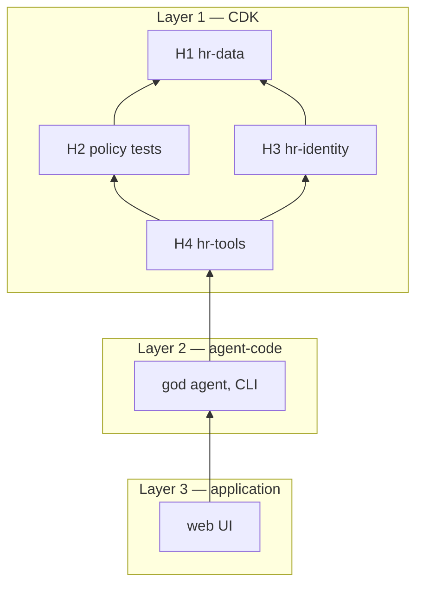

# Build order

Three layers, in this order. Finish a layer's verify command before anyone starts the next layer. This is the same split the repository already enforces: CDK lives under `use-cases/` and `stacks/`, the runtime image lives under `agent-code/`, and a UI consumes the runtime without importing either. `docs/REPOSITORY_STRUCTURE.md` is the rule. Runtime code does not import `stacks` or `infra_utils`. A use case does not import `stacks`. The UI does not import CDK objects.

The platform modules stay as they are (`docs/modules/README.md`). HR is not a new number in `MODULE_MAP`. The product adds three use-case stacks inside layer 1. A use-case stack name starts with `uc-`. `expected_stacks()` picks it up when `platform.yaml` lists it.

Columns, the seed, the OPA input, tool arguments, and the acceptance matrix are in [`docs/hr/`](../docs/hr/README.md). If this file and `docs/hr/` disagree about a field or an error code, `docs/hr/` wins. `review.md` holds the product rules.

## Layer 1 — infrastructure

CDK only. No god agent, no CLI chat, no web page.

| Step | Where it lives | Deploy | Prove it before the next step |
|---|---|---|---|
| H1 `hr-data` | `use-cases/hr-data/` | `./scripts/deploy.sh deploy --stack {prefix}-uc-hr-data` | `python use-cases/hr-data/verify.py` |
| H2 policy | `use-cases/hr-tools/policy/authz.rego` and `tests/test_hr_authz.py` | no stack | `pytest tests/test_hr_authz.py` |
| H3 `hr-identity` | `use-cases/hr-identity/` | `./scripts/deploy.sh deploy --stack {prefix}-uc-hr-identity` | `python use-cases/hr-identity/verify.py` |
| H4 `hr-tools` | `use-cases/hr-tools/` | `./scripts/deploy.sh deploy --stack {prefix}-uc-hr-tools` | `python use-cases/hr-tools/verify.py` |

H1 needs networking and security. H2 and H3 both need H1, and either can go first. H4 needs the gateway, identity, H1, H2, and H3. `requires` in the manifest can only name core stacks. The HR edges are SSM parameters, not CloudFormation exports, so deploy the publisher first. `deploy.sh deploy --stack` does not pass `--exclusively`. A use-case stack must not take a CDK dependency on a platform stack, or that deploy will update the platform stack too.

H4's `verify.py` calls the gateway tools directly, the same way `scripts/test_gateway.py` calls the sample tools. It does not invoke the orchestrator. When it exits 0, the infrastructure layer is done.

## Layer 2 — agent

Starts only after H4's verify exits 0.

The code lives in `agent-code/god-agent/` with a `Dockerfile`, `requirements.txt`, and an entry point. That is the same contract as `agent-code/langgraph-agent/` and `agent-code/agui-langgraph-agent/`. It does not import the CDK app.

Deploy is a redeploy of the existing runtime, module 6, with `agents.pattern: god-agent`. There is no new product stack. Turning it off is a redeploy of the previous pattern.

Prove it from the CLI with the same script Part 1 uses:

```bash
.venv/bin/python scripts/login_chat.py --prompt "How many leaves do I have?"
```

`scripts/invoke.py` is the M2M check the other patterns use. It has no employee id, so a green `invoke.py` does not prove a salary rule. The agent layer is done when the CLI cases in [acceptance](../docs/hr/acceptance.md) pass as E1 and as M1. Sign-in uses a browser once. The questions stay in the terminal.

`login_chat.py` sends `prompt` and `runtimeSessionId`. It has no resume flag. A pause has to come back on that same session id, and the script has to send the decision on that same session. A second sentence that says "approve" is not a decision. The web card is layer 3.

The agent shape is [god-agent.md](god-agent.md). The pauses are [human-review.md](human-review.md).

## Layer 3 — application UI

Starts only after the CLI cases pass.

No CDK stack in v1. The UI is a separate application, the way `dashboard/` is separate from `agent-code/`. It talks to the module 3 web client and the module 6 runtime. It does not import `stacks`, `infra_utils`, or the agent package. Review cards and resume are specified in [human-review.md](human-review.md).

## What depends on what

An arrow means the deployer needs that piece up. It is not a Python import.



| Piece | Skip it when |
|---|---|
| H1 | you are not storing employees |
| H2 | you are only standing up an empty database |
| H3 | you are running unit tests and not calling the gateway as a person |
| H4 | you do not want a callable HR API yet |
| God agent | `use-cases/hr-tools/verify.py` is the proof you wanted |
| Web UI | CLI chat is enough |

## Deploy and destroy

Deploy only that stack. The platform deploy refuses to delete a stack that something else still imports. Destroy dependents first.

```bash
# one module
./scripts/deploy.sh deploy --stack agentcore-production-prod-uc-hr-data

# remove it, and only it
./scripts/deploy.sh destroy --stack agentcore-production-prod-uc-hr-data
```

Destroy order, when someone wants the HR pieces gone and the platform left running. Stop after any step if that is all you wanted to remove.

1. Stop the layer 3 UI. It is a local process, not a stack.
2. Redeploy module 6 with the previous `agents.pattern` if the god agent was turned on. Do not destroy `runtime-orchestrator`. The platform agent still uses it.
3. `destroy --stack {prefix}-uc-hr-tools`
4. `destroy --stack {prefix}-uc-hr-identity` (detaches the Cognito trigger, leaves the user pool)
5. `destroy --stack {prefix}-uc-hr-data`

`destroy --stack` passes `--exclusively`, so it does not delete the platform. The HR stacks do not export to each other, so CloudFormation may allow deleting H1 while H4 still exists. Do not do that. Delete in the order above. If an error names an export still in use, destroy the stack named in the error first.

Do not destroy `auth`, `security`, or `networking` to remove HR. Do not run `destroy` without `--stack`. That deletes the whole footprint. Do not run `design --profile` on this checkout. Without `--profile`, `design` only prints the plan.

Production mode retains stateful data. Destroying H1 removes the stack and keeps the Aurora cluster, the secret, and the backups. It does not drop salary rows. Dropping the data is a separate, explicit step after the stack is gone, and it is not part of `destroy`.

## Layer 1 detail

### H1 — hr-data

Aurora PostgreSQL Serverless v2 in the private subnets from module C. The master secret and storage use the KMS key from module E. Credentials stay in Secrets Manager. The stack publishes the endpoint and the secret name to SSM under `/{project}/{environment}/use-cases/hr-data/`.

Tables: `employees`, `salaries`, `leave_balances`, `leave_requests`, `payroll_items`, `decision_log`. Columns and the seed (M1, E1, R1–R4, P1, X1, E2) are in [`docs/hr/schema.md`](../docs/hr/schema.md). v1 has one row per person. A transfer updates `manager_id` on that row.

This module does not create Lambdas and does not know about OPA. It creates two databases on the one cluster: `hr` for the tables in [`docs/hr/schema.md`](../docs/hr/schema.md), and an empty `agent_state` for the layer 2 checkpointer. The agent creates the checkpoint tables later. It does not create the database.

The laptop is not in the VPC, so H1's `verify.py` does not open a SQL connection. It checks the stack and the SSM parameters. The seed is proved later, when H4's tools call the database from inside the VPC.

Exit: SSM has the endpoint, the secret name, the HR database name, and the checkpoint database name.

### H2 — policy

No stack. The Rego file is `use-cases/hr-tools/policy/authz.rego`, evaluated in-process by the tests and by H4. There is no OPA server to deploy. H4 calls that file before any salary or allowance amount is read. H1 is the only copy of `manager_id`. There is no OPA data bundle to go stale when someone changes team. Input fields and reason codes are in [`docs/hr/policy.md`](../docs/hr/policy.md). The allow rules below are the sketch those tests must keep.

```rego
package hr.authz

default allow = false

allow if {
  input.action == "get_employee_compensation"
  input.target_status == "active"
  input.caller_employee_id == input.requested_employee_id
}

allow if {
  input.action == "get_employee_compensation"
  input.target_status == "active"
  input.target_manager_id == input.caller_employee_id
}

allow if {
  input.action == "get_leave_balance"
  input.caller_employee_id == input.requested_employee_id
}

allow if {
  input.action == "get_allowance"
  input.caller_employee_id == input.requested_employee_id
}

allow if {
  input.action == "check_leave_eligibility"
  input.caller_employee_id == input.requested_employee_id
  not input.on_probation
  input.end_date >= input.start_date
  input.days <= input.remaining_days
  not input.overlaps_existing
}

allow if {
  input.action == "submit_leave_request"
  input.caller_employee_id == input.requested_employee_id
  not input.on_probation
  input.end_date >= input.start_date
  input.days <= input.remaining_days
  not input.overlaps_existing
}
```

Exit is the Phase 1 unit tests: self and direct reports allowed, manager and peer and skip-level and terminated and unknown all denied with the same text, transfer takes effect on the next call, probation and overlap and balance and idempotent submit, allowance is self-only. OPA unreachable is a deny. No AWS.

### H3 — hr-identity

A Lambda on the existing Cognito user pool (ESSENTIALS), ported from the FAST pre-token pattern. It looks up `employee_id` in H1 by the verified `sub` and adds that claim to the machine token. `role` is the constant `employee` for every active row. Destroy detaches that trigger and leaves module 3's user pool in place. The claim names are in [`docs/hr/modules.md`](../docs/hr/modules.md).

Exit: two test users get two different `employee_id` claims. A terminated employee gets no active claim.

### H4 — hr-tools

Lambdas on the gateway from module 5. Schemas do not include `caller_employee_id`. The Lambda overwrites that field from the H3 claim. It loads `manager_id` and status without the salary column, asks H2, and only then reads the amount.

Cedar permits ship in this same deploy, because the gateway is already `ENFORCE`. Any signed-in employee may invoke `get_employee_compensation`, `get_leave_balance`, `check_leave_eligibility`, `submit_leave_request`, `get_allowance`, and `list_direct_reports`. There is no `approve_leave` and no `list_all_employees`. The gateway role is granted invoke on these functions only.

`get_allowance` reads `payroll_items`. A later finance API replaces the body of that function, not the module boundary.

Exit: the H2 cases pass through `tools/call`, a spoofed caller id still resolves to the token, a stopped OPA or a bad database password does not log a salary, and `decision_log` has a row per call with no amounts. `verify.py` exits 0. Stop. The agent is the next layer.

## Layer 2 detail

### God agent

One agent receives every request. It is not an HR agent. The shape, the three libraries, and the nesting limit are in [god-agent.md](god-agent.md). Human review is in [human-review.md](human-review.md).

Redeploy module 6 with the god-agent pattern. No new stack. Turning this off is a redeploy of module 6 with the previous pattern, not a destroy of the runtime.

Exit: the original questions, the compound question, the name lookup inside the allowed set, and "ignore your instructions" pass as E1 and as M1 through `scripts/login_chat.py`. A leave question reaches the leave sub-sub-agent, and a salary question does not. A pause returns on the same `runtimeSessionId`, and a decision on that session continues it. A chat line that says "approve" does not. Read the runtime log. `deploy.sh verify` and `scripts/invoke.py` are not this test. If `openai.gpt-oss-120b-1:0` routes to the wrong subagent, stop and change the in-region model. Do not use an `eu.` or `us.` profile without an SCP exception. Stop. The UI is the next layer.

## Layer 3 detail

### Web UI

The local UI, aimed at the module 3 web client and the module 6 runtime. Cards for leave, allowance, and direct-report pay. The review cards and the resume call are in [human-review.md](human-review.md). Nothing in this module is a CloudFormation stack until someone later chooses to host it.

Exit: an eligible employee confirms one pending request from the review card, a typed "approve" in chat does not submit, a probation employee never sees the form, the direct manager can approve and the employee cannot approve their own request, E1 sees four salaries and not M1's, and M1 sees his direct reports and not R1–R4.

## Bundles

Pick a row. You do not have to take the rows below it.

| Bundle | Layer | You get |
|---|---|---|
| Database only | 1, H1 | Postgres in the VPC. No tools, no agent, no UI |
| Rules only | 1, H2 on a local database | OPA tests. No AWS beyond a database you already have |
| APIs, no agent | 1, through H4 | Gateway tools. `verify.py` is the proof |
| Agent, no UI | 2 | The god agent on the CLI |
| The goal | 3 | The same agent in the browser, with review cards |

## Rules every HR module keeps

| Rule | Why |
|---|---|
| The model never supplies `caller_employee_id`. | A prompt can claim to be someone else. |
| Unknown, peer, manager, skip-level, and terminated targets get the same denial, with no amount and no "this person exists". | Stops directory probing. |
| OPA down or Postgres down is a deny, not an allow. | A failed check must not fall open. |
| Amounts and leave reasons are not logged on a deny. | Traces must not leak the number. |
| `manager_id` is the current manager. Acting managers and matrix reporting are not in these modules. | One hop matches "my four subordinates". |
| No role bypasses OPA here. | A global HR view is a new Rego rule, reviewed on its own. |
| Probation blocks every leave type, on eligibility and on submit. | The form is not a back door. |
| Submit creates a pending request and does not deduct the balance. | Apply is not approval. |
| The same idempotency key inserts one row. | The form will be clicked twice. |
| Name search runs only inside the ids OPA already allows. | The model must not see the whole company. |

Not in these modules: skip-level reports, acting managers, a live finance API, deducting leave balance when a manager approves, separate A2A runtimes, A2UI, row-level security, and a hosted website.
