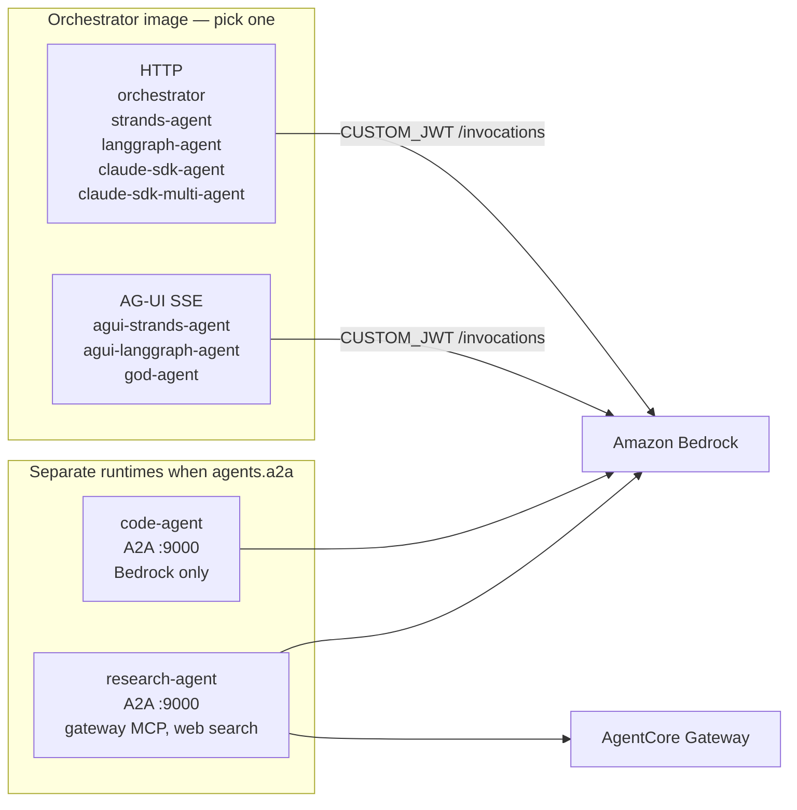
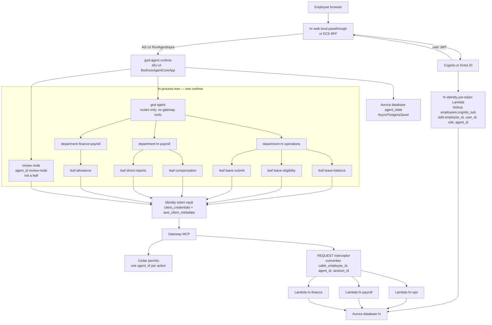

# Layered architecture

This page draws the platform in the same five bands as an enterprise
AgentCore picture: consumer, governance, agent, shared services, and
resources. Every box is a component this repository actually builds.
[`ARCHITECTURE.md`](ARCHITECTURE.md) stays the source of truth for the
request flows that `scripts/verify.py` and `scripts/invoke.py` exercise.
This page is the layer map, including the opt-in HR assistant.

Solid arrows are the data path that exists when the matching stack is
deployed. Dotted arrows are opt-in (`platform.yaml`) or control-plane
reads. A node marked **opt-in** is absent from the workshop default.

The reference picture also shows Kiro, Claude Desktop, Amazon Quick, a
mobile app, and an AgentCore Browser session inside the agent. This
repository does not ship those clients, and no agent pattern calls the
browser APIs. The runtime role grants
`bedrock-agentcore:StartBrowserSession`,
`StopBrowserSession`, and `ConnectBrowserAutomationStream`
(`stacks/runtime_stack.py`), and nothing in `agent-code/` uses them.

## Platform bands

```mermaid
flowchart TB
  subgraph CONSUMER["Consumer layer"]
    direction LR
    subgraph CALLERS["Callers"]
      CLI["CLI<br/>scripts/invoke.py<br/>scripts/login_chat.py"]
      DASH["EBA Console<br/>dashboard/server.py<br/>loopback only"]
      MCPC["MCP caller<br/>scripts/test_gateway.py<br/>or any client with a gateway JWT"]
    end
    subgraph APPS["Applications"]
      LOCAL["hr-web local<br/>hr-web/server.py<br/>127.0.0.1:8899"]
      BFF["hr-web hosted BFF opt-in<br/>WAF + ALB + ECS<br/>DynamoDB sessions"]
    end
    IDP["Issuer<br/>Cognito user pool<br/>or Entra ID / Okta / Ping"]
  end

  subgraph BODY[" "]
    direction LR
    subgraph GOV["Governance layer"]
      SSM["SSM registry<br/>/{project}/{env}/*"]
      OBS["Observability stack<br/>vended logs, X-Ray<br/>Transaction Search"]
      SEC["Security stack opt-in<br/>KMS CMK, CloudTrail"]
      SCP["Org SCPs opt-in<br/>control-library/terraform"]
    end
    subgraph RIGHT[" "]
      direction TB
      subgraph AGENTIC["Agentic AI layer"]
        subgraph ORCH["Orchestrator runtime — one agents.pattern"]
          RT["AgentCore Runtime<br/>ECR + CodeBuild ARM64<br/>CUSTOM_JWT on HTTP and AG-UI"]
          MEM["AgentCore Memory<br/>user preference<br/>semantic strategy opt-in"]
          CI["Code Interpreter<br/>aws.codeinterpreter.v1<br/>pattern-dependent"]
        end
        A2A["A2A runtimes opt-in<br/>code-agent · research-agent<br/>JSON-RPC :9000"]
        PROTO["Protocols on the runtime<br/>HTTP · AG-UI · A2A · MCP"]
      end
      subgraph PLATFORM["AI platform / shared services"]
        CEDAR["Cedar policy engine opt-in<br/>LOG_ONLY or ENFORCE"]
        GW["AgentCore Gateway<br/>MCP · CUSTOM_JWT"]
        BR["Amazon Bedrock<br/>MODEL_ID<br/>allow-list opt-in"]
        IDENT["AgentCore Identity<br/>gateway-m2m token vault<br/>Google / GitHub / Notion 3LO opt-in"]
      end
    end
  end

  subgraph RESOURCE["Resource layer"]
    direction LR
    LAM["Lambda targets<br/>sample-tool<br/>egress interceptor opt-in<br/>hr-ops · hr-payroll · hr-finance opt-in"]
    SEARCH["Built-in MCP connector<br/>web-search<br/>regional, off in production preset"]
    subgraph VPCBOX["VPC — networking stack, opt-in"]
      AURORA["Aurora PostgreSQL opt-in<br/>database hr<br/>database agent_state"]
      VPCE["Interface endpoints<br/>Bedrock runtime, ECR, Logs<br/>AgentCore gateway<br/>AgentCore data plane<br/>S3 gateway endpoint"]
    end
  end

  CLI -->|"OIDC or client_credentials"| IDP
  LOCAL -->|"PKCE in the browser"| IDP
  BFF -->|"confidential client, cookie session"| IDP
  IDP -->|"Bearer JWT"| RT
  LOCAL -->|"AG-UI SSE /invocations"| RT
  BFF -->|"AG-UI SSE via VPC endpoint"| RT
  CLI -->|"HTTP or --agui"| RT
  DASH -->|"Playground invoke"| RT
  MCPC -->|"MCP tools/list · tools/call"| GW

  RT -->|"InvokeModel / Converse"| BR
  RT -->|"M2M token request"| IDENT
  IDENT -->|"client_credentials"| IDP
  RT -->|"MCP + gateway JWT"| GW
  RT -->|"CreateEvent / RetrieveMemoryRecords<br/>patterns that read MEMORY_ID"| MEM
  RT -.->|"Start / Invoke / Stop session<br/>strands, langgraph, agui-*, claude-sdk"| CI
  RT -.->|"InvokeAgentRuntime is on the role<br/>default orchestrator container does not call A2A"| A2A
  A2A -->|"research-agent only"| GW

  CEDAR -.->|"evaluate or block"| GW
  GW --> LAM
  GW -.-> SEARCH
  LAM -.->|"HR tools, RDS IAM auth"| AURORA
  RT -.->|"god-agent checkpointer"| AURORA
  RT -.->|"VPC network mode"| VPCE
  BFF -.-> VPCE

  SSM -.-> RT
  SSM -.-> LOCAL
  SSM -.-> BFF
  SSM -.-> LAM
  RT --> OBS
  GW --> OBS
  SEC -.-> MEM
  SCP -.-> GW
```

## How a call moves

1. The caller signs in at the issuer from the `auth` stack. Workshop
   default is a Cognito user pool with three clients: app (auth code),
   web (auth code + PKCE), and M2M (`client_credentials`), scope
   `agentcore/invoke`. `identity.idp` may be `entra_id`, `okta`, or
   `ping`. `identity.mode: brokered` keeps Cognito as the token issuer
   and federates the IdP through it. `identity.mode: direct` deploys no
   user pool; Entra ID is the issuer and the same `/auth/*` SSM keys
   still publish the discovery URL. The production preset
   (`presets/production.yaml`) is brokered Entra ID.
2. A client-facing runtime (`HTTP`, `AGUI`, or `MCP`) requires a Bearer
   JWT. `infra_utils/runtime_protocol.py` turns that on.
   `A2A` runtimes do not: the orchestrator role is the caller, not an
   end user. `agent-code/shared/auth.py` checks the JWT against the
   issuer JWKS again inside the container.
3. The runtime calls Bedrock with `MODEL_ID` when the stack injects it,
   otherwise the pattern's `DEFAULT_MODEL_ID`. The production preset
   sets `agents.allowed_models` and the runtime role can invoke only
   those ARNs. `security.require_guardrails` adds a baseline guardrail
   and an IAM deny on inference that carries none.
4. Patterns that use tools ask AgentCore Identity for a gateway token.
   The `gateway-m2m` credential provider
   (`stacks/identity_stack.py`) runs `client_credentials` against the
   issuer. The runtime then calls the gateway MCP endpoint with that
   JWT. The god agent does this per leaf and passes
   `aws_client_metadata` so the pre-token Lambda can stamp
   `employee_id` and `agent_id`.
5. The gateway authorizer is `CUSTOM_JWT`. It invokes Lambda targets
   named `{prefix}-tool-*`, or the regional `web-search` connector when
   `gateway.web_search` is on. Cedar, when enabled, is default-deny
   plus explicit permits. `LOG_ONLY` evaluates and logs. `ENFORCE`
   blocks. The production preset is `ENFORCE`.

## Consumer layer

| Surface | Where | What it sends |
|---|---|---|
| CLI | `scripts/invoke.py`, `scripts/login_chat.py` | User JWT to the runtime. `--agui` speaks AG-UI. `--tools` lists gateway MCP tools. |
| Gateway probe | `scripts/test_gateway.py` | MCP `tools/list` and one `tools/call` on the gateway URL. |
| EBA Console | `dashboard/server.py` | Loopback status plus a Playground invoke. No create, update, or delete. |
| Local HR UI | `hr-web/server.py` | Browser PKCE against Cognito. `POST /invocations` forwards only the browser Bearer token and the runtime session header. Binds `127.0.0.1:8899`. |
| Hosted HR UI | `stacks/frontend_stack.py`, `hr-web/bff/app.py` | Opt-in. One ECS Express service (UI + FastAPI), WAFv2, DynamoDB for PKCE state and transcripts. The browser holds an `HttpOnly` cookie `hr_bff_sid`, not the access token. |

There is no mobile client in this repository.

## Governance layer

The picture's "Agent Registry" is SSM Parameter Store. Every stack
publishes under `/{project}/{environment}/`. Use cases, the HR web
server, and the BFF read that prefix. They do not import `stacks/`.
The contract is [`PLATFORM_INTERFACE.md`](PLATFORM_INTERFACE.md).

| Piece | Stack / path | Role |
|---|---|---|
| Registry | SSM `/{project}/{env}/*` | Gateway URL, issuer, runtime ARN, memory id, VPC ids, HR endpoints. |
| Observability | `stacks/observability_stack.py` | Vended application logs, CloudWatch Transaction Search (X-Ray rejects spans without it), optional alarms, SNS, and a platform dashboard. |
| Traceability | same stack, `security.traceability` | EventBridge alerts on sensitive AgentCore API calls. On in the production preset. |
| Security | `stacks/security_stack.py` | KMS CMK for Memory (and SNS), CloudTrail to an S3 bucket. Gated by `security.cloudtrail_alerting`. |
| Org guardrails | `control-library/terraform/org-guardrails/` | Two SCPs per target: consolidated Gateway SCP and Memory CMK SCP. Terraform, not a CDK stack. |
| Local watch | `dashboard/monitor.py` | Classifies the same deployed resources for the console. |

## Agentic AI layer

`app.py` deploys one orchestrator `RuntimeStack` and, when `agents.a2a`
is on, two more: `code-agent` and `research-agent`. Each stack owns an
ECR repository and an ARM64 CodeBuild project. The image rebuilds only
when `infra_utils/source_hash.py` changes. The runtime name uses
underscores (`{project}_{environment}_{component}`) because AgentCore
rejects hyphens.

`agents.pattern` selects the orchestrator image. Protocol comes from
`infra_utils/runtime_protocol.py`: orchestrator is `HTTP`, unless the
pattern is `agui-*` or `god-agent`, in which case it is `AGUI`. A2A
agents are `A2A`. A runtime type of `mcp_server` would be `MCP`; no
shipped stack uses that type. The gateway, not a runtime, is the MCP
server in this repo.

The default `orchestrator` container
(`agent-code/orchestrator/agent.py`) has no tools and does not call
the A2A runtimes. The runtime role still allows
`bedrock-agentcore:InvokeAgentRuntime` because A2A targets do not exist
yet when the role is synthesized. `claude-sdk-multi-agent` keeps its
subagents in-process (`agent-code/claude-sdk-multi-agent/agents/`),
not on the A2A stacks.

`migration.enabled` replaces the orchestrator image with
`migration/adapter/` wrapped around a customer container. The A2A
stacks stay as they are. Only `migration_target_runtime: agentcore`
and `migration_target_mode: adapter` are implemented.

### What each pattern actually calls

| Pattern | Protocol | Gateway MCP | AgentCore Memory | Code Interpreter |
|---|---|---|---|---|
| `orchestrator` | HTTP | no | no | no |
| `strands-agent` | HTTP | yes | yes, if `MEMORY_ID` is set | yes |
| `langgraph-agent` | HTTP | yes | required (`AgentCoreMemorySaver`) | yes |
| `claude-sdk-agent` | HTTP | token via `get_gateway_access_token` | no | in-process MCP `code_int_mcp` |
| `claude-sdk-multi-agent` | HTTP | token via `get_gateway_access_token` | no (in-memory session map) | in-process MCP `code_int_mcp` |
| `agui-strands-agent` | AG-UI | yes | required | yes |
| `agui-langgraph-agent` | AG-UI | yes | required | yes |
| `god-agent` | AG-UI | one tool per leaf | no (`MEMORY_ID` is ignored) | no |
| `code-agent` (A2A stack) | A2A | no | no | no |
| `research-agent` (A2A stack) | A2A | yes | no | no |

Code Interpreter IAM is pinned to the AWS-owned interpreter
`aws.codeinterpreter.v1`. Memory IAM is pinned to this deployment's
memory ARN when the stack knows it. The memory resource itself is
always created (short-term user-preference strategy; semantic long-term
memory is `agents.memory.long_term`). A federated platform account does
not deploy runtimes or memory; each workload account keeps its own
memory. See [`MULTI_ACCOUNT.md`](MULTI_ACCOUNT.md).

## AI platform / shared services

| Service | Code | Notes |
|---|---|---|
| Auth | `stacks/auth_stack.py` | Issuer, clients, optional OIDC federation. Secrets Manager holds the IdP client secret. The value is a `{{resolve:secretsmanager}}` token, never a literal in the template. |
| Identity | `stacks/identity_stack.py` | Always: `{prefix}-gateway-m2m`. Optional 3LO providers for Google, GitHub, and Notion when a client id is passed (context or env, no `platform.yaml` key). Token vaults are account-local, so a federated workload account has its own provider holding the platform M2M secret. |
| Gateway | `stacks/gateway_stack.py` | One MCP endpoint, `CUSTOM_JWT`, role may invoke `{prefix}-tool-*` only. Shipped Lambda tool: `tools/sample_tool/`. Web search is a connector target, on by default only in `us-east-1`, `eu-west-1`, and `ap-northeast-1`. |
| Policy | Cedar on the gateway | `control-library` permit `cedar.gateway-default.permit-read`, plus the HR permits when `hr-tools` is enabled. |
| Egress filter | `tools/egress_interceptor/` | Opt-in. Bedrock Guardrail on gateway REQUEST and RESPONSE (PII and prompt injection). It masks. It does not authorize. |
| Bedrock | runtime role | `InvokeModel`, `InvokeModelWithResponseStream`, `Converse`, `ConverseStream`. |

Cross-account trust, when `deployment.strategy` is `federated`, is OAuth
only. The workload runtime's token vault exchanges the platform M2M
client at the platform issuer. The gateway validates that JWT. There is
no cross-account IAM on the data plane.

## Resource layer

### Tools on the gateway

| Target | Kind | Backing code |
|---|---|---|
| `sample-tool` | Lambda | `tools/sample_tool/handler.py` — `text_analysis_tool`. Tool name arrives as `bedrockAgentCoreToolName` (`target___tool`). |
| `web-search` | Built-in connector | No Lambda. Gateway role needs `bedrock-agentcore:InvokeWebSearch` on `arn:aws:bedrock-agentcore:<region>:aws:tool/web-search.v1`. |
| `hr-ops` | Lambda, use case | `get_leave_balance`, `check_leave_eligibility`, `submit_leave_request`, `record_leave_decision`. |
| `hr-payroll` | Lambda, use case | `get_employee_compensation`, `list_direct_reports`. |
| `hr-finance` | Lambda, use case | `get_allowance`. |

There is no separate REST "APIs" product and no `approve_leave`,
`list_all_employees`, or `execute_sql` tool. A live finance API is
explicitly out of v1 (`docs/hr/README.md`).

### VPC

`stacks/networking_stack.py` builds a VPC (`10.0.0.0/16` unless
overridden), two AZs, one NAT gateway, public subnets with
`map_public_ip_on_launch` false, and private subnets with egress.
Runtimes in VPC mode land in the private subnets. Their security group
allows outbound 443 only. Callers still reach the runtime through the
AgentCore data plane, not through an inbound port on the ENI.

When VPC endpoints are on, the stack adds interface endpoints for
Bedrock runtime, ECR API, ECR Docker, CloudWatch Logs, the AgentCore
gateway (`com.amazonaws.<region>.bedrock-agentcore.gateway`), and the
AgentCore data plane (Memory, Identity, Code Interpreter). S3 is a
gateway endpoint. An org id attaches `vpce.agentcore-in-org` to the
gateway endpoint only. The data-plane endpoint stays open to the VPC
CIDR so the BFF can invoke the runtime through it.
`security` resource policies can restrict that invoke to
`aws:SourceVpce`.

`use-cases/hr-data/` places Aurora PostgreSQL Serverless v2 in those
private subnets, encrypted with the security-stack CMK. It creates
database `hr` and an empty database `agent_state`. Roles are
`hr_reader`, `hr_writer`, `hr_audit`, `hr_identity`, and
`agent_checkpoint`. The master secret is for schema apply. Lambdas use
RDS IAM authentication. `retain_data` defaults to true for this use
case: destroying the stack keeps the cluster.

## HR assistant — the concrete agent

Enable `hr-data`, `hr-identity`, and `hr-tools` in `platform.yaml`, and
set `agents.pattern` to `god-agent`. That is the only end-to-end
business agent in the tree. It needs the networking stack and the
security stack because Aurora sits in the VPC and uses the CMK.

Leaf to tool, from `agent-code/god-agent/gateway_client.py` and
[`docs/hr/tools.md`](hr/tools.md):

| Leaf `agent_id` | Department | Gateway tool |
|---|---|---|
| `leave-balance` | `hr-operations` | `hr-ops___get_leave_balance` |
| `leave-eligibility` | `hr-operations` | `hr-ops___check_leave_eligibility` |
| `leave-submit` | `hr-operations` | `hr-ops___submit_leave_request` |
| `compensation` | `hr-payroll` | `hr-payroll___get_employee_compensation` |
| `direct-reports` | `hr-payroll` | `hr-payroll___list_direct_reports` |
| `allowance` | `finance-payroll` | `hr-finance___get_allowance` |
| `review-node` | runtime review, not a leaf | `hr-ops___record_leave_decision` |

The god agent cannot call the six tools itself. Each leaf has one tool,
`ModelCallLimitMiddleware` run limit 4, and `ToolCallLimitMiddleware`
run limit 2. A per-employee limit of 20 turns per 10 minutes runs
before any Bedrock call. The kill switch
`/{project}/{environment}/use-cases/hr-tools/enabled` is re-read on
each invocation (30 s cache) and turns every HR tool into
`SERVICE_DISABLED` without a redeploy.

Authorization is two steps. Cedar allows the call only when the token
carries the leaf's `agent_id`. The Lambda then runs `authz.py` for the
row rule (self, or the target's direct manager, one hop). A deny is a
normal tool result with `authorized: false`, not a Lambda exception.
`record_leave_decision` is not on any leaf. The review node calls it
after the manager confirms in the UI.

`hr-identity` attaches a Cognito pre-token-generation V3_0 trigger.
Human triggers (`HostedAuth`, `Authentication`, `RefreshTokens`) add
`employee_id`, `user_id`, and `role` to the access token and the ID
token. They never add `agent_id`. The M2M trigger
(`ClientCredentials`) is the leaf path: the runtime copies the verified
user `sub` into `clientMetadata.verified_user_id` and the leaf name into
`calling_agent`. The handler looks up `employees.cognito_sub` and adds
`agent_id` only when `calling_agent` is one of the seven allowed names.
For federated Entra logins, `event.userName` is `EntraID_<oid>`. The
lookup key on a human trigger is `request.userAttributes.sub`, not
`userName`. A missing active employee row returns the event unchanged
(`NOT_MAPPED` later). The model cannot set `verified_user_id`.

The checkpointer is `AsyncPostgresSaver` on `agent_state`. AgentCore
Memory is not the interrupt store. Pending manager reviews live in that
database. The UI renders tool results through A2UI
(`hr-web/web/src/a2ui/` and `hr-web/public/`). Confirm on
`EmployeeConfirmForm` is required before `submit_leave_request`.
Approve or Reject on `ManagerReviewCard` is required before
`record_leave_decision`.

## Stacks the CDK app composes

`app.py` is the composition root. `expected_stacks()` in
`infra_utils/platform_config.py` is the deployment contract. A use case
named in `platform.yaml` `use_cases` adds `use-cases/<name>/stack.py`
without editing the platform stacks.

| Stack | Always? | Depends on |
|---|---|---|
| `networking` | `security.networking` | — |
| `security` | `security.cloudtrail_alerting` | — |
| `auth` | yes, except a federated workload account | — |
| `identity` | yes, both sides of a federation | auth, when auth exists in this account |
| `memory` | yes, except a federated platform account | auth, security when the CMK exists |
| `gateway` | yes, except a federated workload account | auth |
| `runtime-orchestrator` | yes, except a federated platform account | gateway, memory, identity, networking when on |
| `runtime-code-agent`, `runtime-research-agent` | `agents.a2a` | auth, networking; research also gateway and identity |
| `frontend` | `frontend` enabled | networking (it needs the VPC) |
| `observability` | yes | the resource stacks it monitors |
| `uc-hr-data`, `uc-hr-identity`, `uc-hr-tools` | named in `use_cases` | SSM interface only; no Python import of `stacks/` |

The edge list that `add_dependency()` actually creates is in
[`modules/README.md`](modules/README.md).

## Production preset versus workshop default

`presets/production.yaml` is a centralized account, brokered Entra ID,
pattern `strands-agent`, an explicit model allow-list, web search off,
networking, CloudTrail, resource policies, egress filter, required
guardrails, Cedar `ENFORCE`, traceability, Transaction Search, and
alarms. Stateful resources are retained. Sentinels in that file are not
a launch approval.

Workshop defaults in `app.py`, when `platform.yaml` does not override
them: Cognito, pattern `orchestrator`, networking off, Cedar off,
egress filter off, guardrails off. `ENABLE_A2A` defaults to true on the
legacy env path and `agents.a2a` defaults to false in the YAML schema.
Those two defaults are different on purpose.
